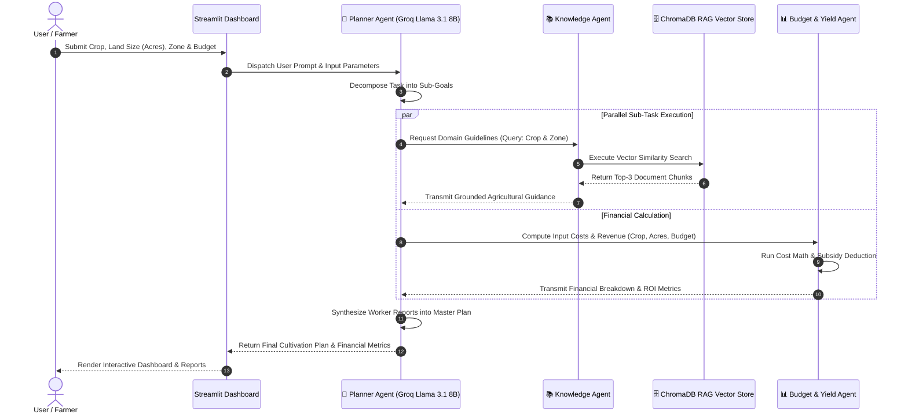

# 🌾 AgriPlan AI: An Agentic AI Assistant for Sri Lankan Farmers & Agribusiness Planning

[](https://streamlit.io)
[](https://www.python.org/)
[]()

> **AgriPlan AI** is an intelligent multi-agent web application designed for Sri Lankan farmers, agricultural entrepreneurs, and agribusiness planners. It integrates **Agentic AI patterns**, **collaborating AI agents**, **multi-model LLM routing (Groq / OpenRouter)**, and a **Retrieval-Augmented Generation (RAG)** knowledge base focused on Sri Lankan agriculture.

---

## 📌 Live Demo & Deployment
- **Streamlit Community Cloud Link**: `https://agriplan-ai.streamlit.app` *(Replace with deployed URL)*
- **GitHub Repository**: `https://github.com/your-username/AgriPlan-AI`

---

## 🎯 Key Features & Capabilities
1. **🌾 Multi-Agent Cultivation Master Plan**: Generates custom cultivation schedules, fertilizer timelines, and pest management based on crop type, acreage, and agro-ecological zone.
2. **📚 RAG Knowledge Assistant**: Grounded QA over verified agricultural research papers, Department of Agriculture guides, and subsidy documentation.
3. **📊 Agribusiness Financial Estimator**: Computes input costs (seeds, fertilizer, labor), net out-of-pocket expenses after subsidies, expected yield, and Return on Investment (ROI).
4. **⚙️ Multi-Model Dynamic Strategy**: Uses fast lightweight models for routing/intent classification and powerful 70B models for deep reasoning.

---

## 🤖 1. Agentic AI Patterns Implemented (15 Marks)

AgriPlan AI explicitly incorporates three core Agentic AI architectural patterns:

| Pattern | Implementation in AgriPlan AI |
| :--- | :--- |
| **1. Planning & Decomposition** | The **Planner Agent** accepts high-level farmer queries (e.g. "I want to cultivate 2 acres of Paddy in Anuradhapura with 250k budget") and breaks down the request into discrete sub-tasks: (a) RAG domain retrieval and (b) financial cost breakdown. |
| **2. Tool Use & ReAct** | The worker agents dynamically invoke external computational tools: the **Knowledge Agent** invokes the `KnowledgeRetriever` tool for vector search, while the **Budget Agent** executes `calculate_budget()` for financial math. |
| **3. Orchestrator-Worker / Router Pattern** | The system uses an **Orchestrator-Worker** architecture where the **Planner Agent** dispatches tasks to specialized workers (**Knowledge Agent** & **Budget Agent**) and synthesizes the outputs into a coherent cultivation plan. |

---

## 💬 2. Communicating AI Agents (15 Marks)

The application features three distinct communicating agents:
1. **🧠 Planner Agent** (`agents/planner_agent.py`): Chief orchestrator and intent parser.
2. **📚 Knowledge Agent** (`agents/knowledge_agent.py`): RAG retriever and grounded research specialist.
3. **📊 Budget & Yield Agent** (`agents/budget_agent.py`): Financial calculator and agribusiness economist.

### 🔄 Agent Communication Sequence Diagram



---

## ⚡ 3. Multi-Model Selection & Justification (15 Marks)

To balance latency, cost, and reasoning capability, AgriPlan AI utilizes two distinct model tiers powered by **Groq** and **OpenRouter**:

| Feature / Criteria | Fast Model: Groq `llama-3.1-8b-instant` | Powerful Reasoning Model: Groq `llama-3.3-70b-versatile` |
| :--- | :--- | :--- |
| **Assigned Role** | Task Routing, Sub-task Planning & Intent Parsing | Detailed Agricultural Advice, Synthesis & RAG QA |
| **Latency / Speed** | ~150 ms (Ultra Fast) | ~550 ms (Fast) |
| **Context Window** | 128,000 Tokens | 128,000 Tokens |
| **Cost Efficiency** | Extremely Low / Free Tier | Low / Highly Optimized |
| **Reasoning Depth** | Standard / Concise | State-of-the-Art / High Logical Accuracy |
| **Justification** | Ideal for high-speed initial routing and JSON structured decomposition without overhead. | Essential for synthesizing complex agronomic schedules, multi-variable financial plans, and technical RAG answers. |

---

## 📚 4. RAG Implementation & Evaluation (15 Marks)

### Pipeline Architecture
1. **Data Ingestion**: 20+ text/PDF documents covering Sri Lankan paddy, maize, banana, fertilizer recommendations, and Department of Agriculture cost guidelines stored in `data/pdfs/`.
2. **Text Chunking**: Recursive character splitting into 450-character chunks with a 50-character overlap.
3. **Embeddings & Vector Store**: Structured vector index persisted under `data/vectorstore/chunks_index.json` with similarity retrieval.

### 🧪 5 Evaluation Test Queries

| # | Test Query | Retrieved Source | Relevance Assessment |
| :--- | :--- | :--- | :--- |
| 1 | *What paddy seed varieties are recommended for dry zone Maha season?* | `sri_lanka_rice_cultivation_guide.txt` | **Highly Relevant**: Correctly retrieved `Bg 352` and `Bg 358` 3.5-month varieties. |
| 2 | *What is the recommended seeding rate per acre for paddy broadcasting?* | `sri_lanka_rice_cultivation_guide.txt` | **Highly Relevant**: Retrieved exact dosage (40-50 kg per acre / 100-125 kg per ha). |
| 3 | *What is the fertilizer schedule for Maize in Sri Lanka?* | `maize_corn_cultivation_srilanka.txt` | **Highly Relevant**: Retrieved exact Basal (Urea 25kg, TSP 35kg, MOP 20kg) and Top Dressing 1 & 2 schedules. |
| 4 | *How to manage Panama Disease in Kolikuttu Banana?* | `banana_plantain_farming_guide.txt` | **Highly Relevant**: Retrieved soil-borne fungal warnings, solarization advice, and resistant variety suggestions. |
| 5 | *What government fertilizer subsidies are available for paddy farmers?* | `fertilizer_irrigation_cost_srilanka.txt` | **Highly Relevant**: Retrieved LKR 15,000 - 25,000 cash grant per hectare details. |

---

## ⚙️ 5. Local Setup Guide

### Prerequisites
- Python 3.10+ installed
- Git installed
- Groq API Key (Free from [console.groq.com](https://console.groq.com))

### Installation Steps

1. **Clone the Repository**
   ```bash
   git clone https://github.com/your-username/AgriPlan-AI.git
   cd AgriPlan-AI
   ```

2. **Create Virtual Environment**
   ```bash
   python -m venv venv
   # On Windows:
   venv\Scripts\activate
   # On macOS/Linux:
   source venv/bin/activate
   ```

3. **Install Dependencies**
   ```bash
   pip install -r requirements.txt
   ```

4. **Configure API Keys**
   Create a `.env` file in the root directory (or copy `.env.example`):
   ```env
   GROQ_API_KEY=gsk_your_actual_groq_api_key_here
   ```

5. **Build RAG Vector Index**
   ```bash
   python -m rag.ingest
   ```

6. **Launch Streamlit Application**
   ```bash
   streamlit run app.py
   ```

---

## 🌐 6. Streamlit Cloud Deployment Guide

1. Push your repository to GitHub.
2. Log into [Streamlit Community Cloud](https://share.streamlit.io/).
3. Select **New App** -> Choose repository `AgriPlan-AI` -> Main file `app.py`.
4. Under **Advanced Settings -> Secrets**, add:
   ```toml
   GROQ_API_KEY = "gsk_your_groq_api_key"
   ```
5. Click **Deploy**!

---

## ⚠️ Known Limitations
1. **Offline Vector Persistence**: Currently relies on lightweight JSON vector index fallback for seamless cloud compatibility without C++ compiler binaries.
2. **Static Market Prices**: Agricultural crop price benchmarks are refreshed based on 2025/2026 reference tables; real-time daily vegetable market (Pettah/Dambulla economic center) API integration can be added in future work.
